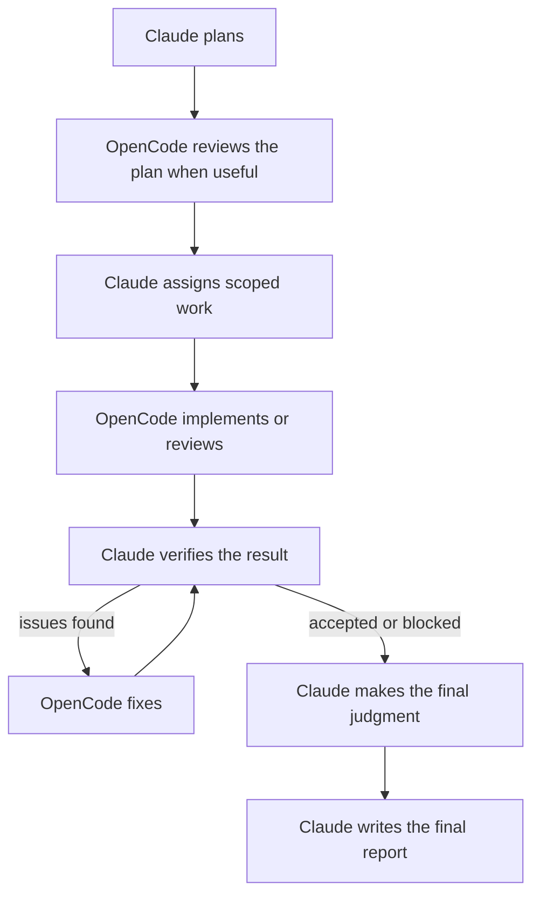

# Claude–OpenCode Orchestrator Plugin

A Claude Code plugin for coordinating headless [OpenCode](https://opencode.ai) agents. Claude plans
and verifies the work; OpenCode handles scoped implementation and review through `opencode run`,
with any model OpenCode can reach — DeepSeek, GLM, Kimi, Nemotron, Gemini, GPT, local models, and
OpenCode's free models.

The orchestration framework (skills, run journal contract, handoff shape, review and consensus
rules, and close procedure) is adapted from
[alexzh3/codex-orchestrator](https://github.com/alexzh3/codex-orchestrator). This plugin replaces
the Codex CLI layer with a launcher built around OpenCode's real headless behavior.

## Quick Install

One command (checks prerequisites, then installs the plugin into Claude Code):

```bash
curl -fsSL https://raw.githubusercontent.com/hassanbaigy/opencode-orchestrator/main/install.sh | bash -s -- --with-sandbox
```

Options: `--scope user|project|local` (default `user`), `--with-sandbox` (installs the OS sandbox,
recommended), `--dry-run`. Or from inside Claude Code:

```text
/plugin marketplace add hassanbaigy/opencode-orchestrator
/plugin install opencode-orchestrator@opencode-orchestrator
```

Then restart Claude Code and run `/opencode-orchestrator:workflow` with a task.

## What It Does

Use this plugin when you want Claude Code to supervise OpenCode agents rather than manually relay
context between tools. It helps Claude:

- assign or resume scoped OpenCode agents on any provider/model;
- launch them headlessly with a permission policy and a timeout;
- preserve exact prompts, raw event streams, exit records, and handoffs;
- independently verify results and record consequential decisions.

## Why A Launcher

`opencode run --format json` works well headlessly, but differs from `codex exec` in ways that
matter for unattended orchestration. The bundled `launch` command handles each one:

| OpenCode behavior | What the launcher does |
| --- | --- |
| No `--output-last-message` | Writes the exact final assistant message to `handoff.md` |
| A permission left at `ask` is auto-rejected, and the process still exits 0 | Classifies the run as `incomplete` and lists `permission_rejections` |
| No end-of-run event; the stream just stops | Records exit code, finish reason, and timeout in `exit.json` |
| No OS sandbox | Runs OpenCode inside Anthropic's sandbox-runtime (`srt`: Seatbelt / bubblewrap + domain-allowlist proxy) when installed, on top of `implement` / `review` / `readonly` permission profiles |
| Shell commands can write files even when edit tools are denied | Diffs `git status` and HEAD before and after; flags `profile_violation` |
| Weaker models sometimes put their answer above empty headings | Checks handoff shape (`handoff_ok`) and documents a one-step repair |
| Concurrent runs can die at startup on OpenCode's locked local database | Retries only that no-event startup failure (`startup_retries`) |
| No way to cancel a headless run cleanly | `stop` ends the process group and records `stopped` with a reason |
| Provider routing lives in config | `--model-options` merges per-model options and records them redacted |
| A provider key could leak into model output | Flags the variable names of real secret values found in run output |
| Agents without installed dependencies cannot type-check or test, and ship errors | `--setup` installs outside the sandbox; `--check` runs your acceptance commands inside it; `--fix-rounds` feeds failures back to the same session |
| Agents sometimes delete tests to make a suite pass | Lists removed test definitions in `exit.json.test_definitions` |

## Requirements

- [Claude Code](https://code.claude.com/docs/en/overview).
- [OpenCode](https://opencode.ai/docs/cli/) with at least one working provider (`opencode models`).
- Python 3.9 or newer for the bundled tools (standard library only).
- Recommended: [Anthropic sandbox-runtime](https://github.com/anthropics/sandbox-runtime)
  (`npm install -g @anthropic-ai/sandbox-runtime`) for the OS sandbox on macOS and Linux.
- A Git repository.
- A meaningful verification path such as tests, typecheck, lint, build, or manual inspection.

## Installation

From Claude Code:

```text
/plugin marketplace add hassanbaigy/opencode-orchestrator
/plugin install opencode-orchestrator@opencode-orchestrator
/reload-plugins
```

## Usage

Use `orchestrate` for one focused phase and `workflow` for the complete end-to-end process.

| Command | Purpose |
| --- | --- |
| `/opencode-orchestrator:orchestrate` | Run a focused execution, review, monitoring, or verification phase within a run. |
| `/opencode-orchestrator:workflow` | Run planning through execution, verification, closure, and report. |
| `/opencode-orchestrator:report` | Author `report.md` from an already closed run. |

For example:

```text
/opencode-orchestrator:workflow

Add input validation to the signup endpoint. Implement with
openrouter/deepseek/deepseek-v4-pro and have a fresh opencode/big-pickle agent review the commit.
```

The bundled tool can also be used directly:

```bash
TOOLS=<plugin-root>/scripts/opencode_orch_tools.py
python3 $TOOLS launch --execution-dir <dir-with-prompt.md> --worktree <abs-path> \
  --model openrouter/deepseek/deepseek-v4-pro --profile implement --timeout 3600 \
  --setup "pnpm install --frozen-lockfile --prefer-offline" \
  --check "pnpm exec tsc --noEmit" --fix-rounds 2
python3 $TOOLS stop --execution-dir <dir> --reason "prompt superseded"
python3 $TOOLS state <session-id> --file <dir>/events.jsonl --json
python3 $TOOLS monitor --repo <repo> --run-id <run-id>
python3 $TOOLS validate <repo>/.opencode-orchestrator/runs/<run-id>
```

The operating instructions live in [`skills/orchestrate/SKILL.md`](skills/orchestrate/SKILL.md),
[`skills/workflow/SKILL.md`](skills/workflow/SKILL.md), and
[`skills/report/SKILL.md`](skills/report/SKILL.md).

## Workflow



## Run Layout

Runs live under `.opencode-orchestrator/runs/<run-id>/`. Before creating a run, the workflow adds
`/.opencode-orchestrator/` to the repository's local `.git/info/exclude` and verifies it is ignored;
it does not modify the tracked `.gitignore`.

```text
journal.jsonl
opencode-impl-01/
  execution-01/
    prompt.md
    events.jsonl
    stderr.log
    exit.json
    handoff.md
evidence/                 # optional
report.md                 # written by Claude after run closure
```

Each top-level agent directory is a persistent execution context. Every prompt, event stream, and
handoff cycle gets the next numbered execution; resuming a native session creates another execution
under the same agent. The journal format, trust boundaries, and closure flow are documented in
[`docs/orchestration-contract.md`](docs/orchestration-contract.md).

## Model Hardening

The launcher and prompts were exercised against nine models (DeepSeek V4 Pro and Flash, GLM, Kimi,
Nemotron via OpenRouter and OpenCode Zen, big-pickle, MiMo, Ling) on implement, independent review,
resume, adversarial-review, missing-key, invalid-model, and timeout scenarios. Results and the
behaviors they revealed are in
[`skills/orchestrate/references/models.md`](skills/orchestrate/references/models.md). They are
directional, single-run observations, not a benchmark.

## Limitations

- Without `srt`, protection is policy-only: shell commands can still reach anything the user can.
  With `srt`, the sandbox confines writes and network, but it is not a VM; run hostile code in a
  container or VM.
- Sequential review and fix loops may take longer than using one agent.
- Parallel work requires isolated files, resources, or worktrees, and parallel agents on one
  provider share its rate limit.
- Conclusions are only as reliable as the available checks and evidence.

## Security And Privacy

With `srt` installed, OpenCode runs in an OS sandbox: writes are confined to the worktree (none at
all for `readonly`), its Git metadata, OpenCode's data, tool caches and temp; credential stores and
`.env` files are unreadable; and network access is limited to the model provider's API and
`models.dev` through `srt`'s domain-allowlist proxy. Each execution's policy is saved as
`sandbox.json`, and blocked actions are listed in `exit.json.sandbox_blocks`.

On top of that, every profile denies reading `.env` files, file tools outside the worktree, network tools,
`curl`/`wget`, `printenv`, and outward-facing or privileged commands (`git push`, `gh`, package
publishing, cloud and secret-manager CLIs, `sudo`, `ssh`, `docker`, `kubectl`). Use
`--allow-network` only with explicit authorization.

The plugin adds no telemetry of its own. Data handling follows the configured Claude Code,
OpenCode, and model-provider environments, which may see files, prompts, diffs, and command output
you make available. Keep secrets and sensitive production data out of scope.

## Development

```bash
python3 -m unittest discover -s tests -q
```

## License

MIT. See [LICENSE](LICENSE); includes the copyright notice of the adapted codex-orchestrator.
